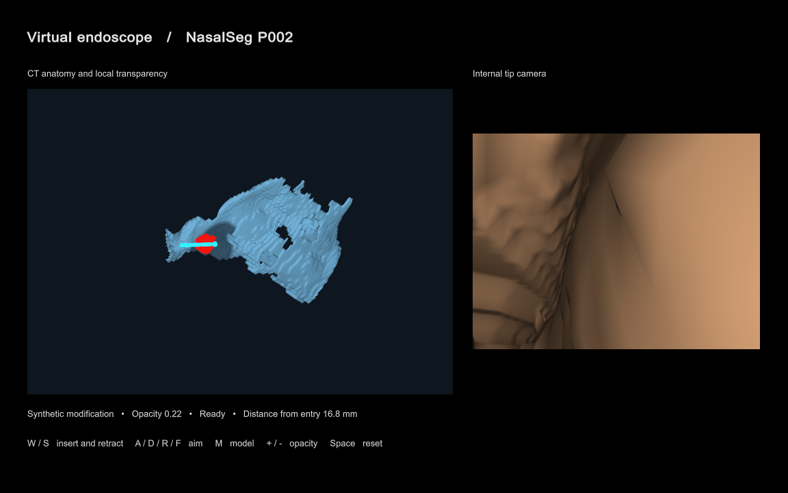

# Virtual Endoscope with See-through AR Visualization

A course prototype for endoscopic sinus surgery visualization. A joystick-controlled virtual rigid endoscope navigates a CT-derived nasal passage. The accepted scope pose drives the shaft, a spherical transparency window in the external anatomy view, and a separate endoscope-tip camera. The demo uses a virtual patient and renders the camera image from the 3D model.



## Status

| Component | Status |
| --- | --- |
| Python / Open3D prototype | Keyboard interaction and automated motion and rendering checks verified on macOS |
| NasalSeg P002 nasal entry | One CT-derived entry route implemented and verified offline |
| Unity desktop demo | Scene, macOS build, and actual two-view rendering verified |
| Quest 3 build | Signed Android ARM64 APK built; OpenXR, passthrough and Touch controller inputs configured |
| Quest 3 hardware | Install and on-headset checks still pending |
| Physical phantom | Optional extension; physical registration is outside this demo |

The red overlay represents a deliberately introduced local change in the model. The application is an educational simulation and provides no clinical guidance.

## Repository layout

| Path | Contents |
| --- | --- |
| [`python-demo/`](python-demo/) | Python demo, P002 geometry, asset generators, audit and verification scripts |
| [`unity/`](unity/) | Unity project, scene, C# motion and rendering code, shaders, XR settings and export tool |
| [`builds/`](builds/) | Prebuilt macOS app archive and Quest 3 APK |
| [`docs/`](docs/) | Unity preview and verification notes |

## Run the prebuilt Mac demo

1. Download [VirtualEndoscope-macOS.zip](builds/VirtualEndoscope-macOS.zip) and extract it.
2. Open `VirtualEndoscope.app` on an Apple Silicon Mac.
3. The P002 CT model appears on the left and the tip camera appears on the right.

This build was produced locally for course testing. macOS may display a Gatekeeper prompt; the Unity editor workflow below is another way to run it.

| Action | Unity on Mac | Python on Mac | Quest Touch |
| --- | --- | --- | --- |
| Insert / withdraw | W / S | W / S | Right stick up / down |
| Aim left / right | A / D | A / D | Hold right trigger and move right stick |
| Aim up / down | R / F | R / F | Hold right trigger and move right stick |
| Toggle model | M | M | A on right controller |
| Change window opacity | + / - | + / - | Left stick up / down |
| Reset | Space | Restart the demo | B on right controller |
| Quit | Close the window | Q or Esc | Quit via headset system menu |

## Run the Python demo from source

The local verification environment used Python 3.10.12 on macOS arm64. Python dependencies are pinned in [requirements.txt](python-demo/requirements.txt). The GUI requires the windowed OpenCV package and a graphical desktop. A fresh Conda environment can be created as follows:

```bash
conda create -n virtual-endoscope python=3.10 -y
conda activate virtual-endoscope
cd python-demo
python -m pip install -r requirements.txt
python demo.py
```

The checked-in derived P002 assets are sufficient to run this demo. Pass `--assets path/to/assets` to switch asset sets.

### Rebuild and validate P002

Download `NasalSeg.zip` from the [NasalSeg v2 dataset record](https://zenodo.org/records/13893419). The published MD5 is `ba83df47974d907798542101fa43ac7d`. From `python-demo`:

```bash
python check_nasalseg.py /path/to/NasalSeg.zip > nasalseg-audit.json
python prepare_p002.py /path/to/NasalSeg.zip
python verify_p002.py /path/to/NasalSeg.zip --output p002-evaluation
```

The preparer reads the P002 CT and segmentation, verifies their physical grid, and constructs closed collision boundaries and separate visible surface meshes. The validator writes a JSON trajectory record and a preview. A previously verified report is included as [p002-validation.json](python-demo/p002-validation.json).

### Optional original p04_left workflow

The p04_left workflow starts inside the airway and includes a replay and five-direction regression check. Obtain the sample separately via the [upstream An Endoscopic Chisel repository](https://github.com/janemilym/ct-update). Once the original sample layout has been extracted:

```bash
python prepare.py --source /path/to/p04_left --output assets
python demo.py --assets assets
python verify.py --assets assets --output p04-evaluation
python replay.py --assets assets --output p04-replay.json
python replay.py --assets assets --play
```

The raw p04_left sample and its derived meshes and images stay with the upstream or local working copy. The preparation, demo, replay and verification code are included here.

## Open and build the Unity project

Use Unity Hub to install **Unity 6.6.10f1 (6000.6.10f1)**, using the Apple Silicon editor on an arm64 Mac. For Android, install **Android Build Support**, **Android SDK & NDK Tools**, and **OpenJDK**. Unity Package Manager resolves the version-locked dependencies on the first import, including Input System, OpenXR and Unity OpenXR Meta.

1. Add the `unity` directory as a project in Unity Hub.
2. Open `Assets/Endoscope.unity`, enter Play mode, and focus the Game view.
3. Run **Endoscope > Validate P002 motion** for the motion regression suite.
4. Run **Endoscope > Build Mac app** or **Endoscope > Build Quest 3 APK**. Builds are written to `unity/Builds/`.

To regenerate the Unity patient asset after rebuilding the Python geometry, run this command from the repository root in the same Python environment:

```bash
python unity/Tools/export_patient.py python-demo/assets-p002 unity/Assets/Resources/P002.bytes
```

The exporter places the P002 entry at the Unity origin, converts source LPS millimetres to Unity metres, reflects the vertical camera axis, fixes triangle winding, and packs the visible surfaces and collision acceleration trees.

## Install and verify on Quest 3

Use [VirtualEndoscope-Quest.apk](builds/VirtualEndoscope-Quest.apk) or build a fresh APK. Enable Developer Mode on the headset, connect it by USB, and accept its USB debugging prompt. With Android platform tools available:

```bash
adb devices
adb install -r builds/VirtualEndoscope-Quest.apk
```

Open **Virtual Endoscope** from the headset app library under **Unknown Sources**. The virtual patient and tip-camera panel are placed in front of the initial tracked head pose. The B button resets the scope and places the objects again. Verify passthrough, head tracking, stereo visibility, both controller inputs, both views, model switching and collision rejection on device. APK signature and manifest validation were performed on the Mac.

## How the demo works

- **Entry and scope.** P002 uses one CT-derived entry pose near the nostril, an approximately 14 mm shaft centerline, a 0.8 mm collision radius and a 0.5 mm fixed camera offset. The entry was estimated from the CT and segmentation.
- **Permitted motion.** The controller requests translation or rotation. The system checks the tip and full shaft through the candidate sweep against both the baseline and modified permitted-space boundaries. A rejected request retains the previous accepted pose.
- **External view.** A 12 mm spherical window follows the tip, with a soft transition and adjustable opacity. The visible shaft and tip use the same accepted pose.
- **Internal view.** A separate camera renders the selected model from the virtual lens. The camera output appears next to the external view on Mac and on a separate panel in XR.
- **Synthetic change.** A small known wall displacement is visualized in red when the modified model is selected and the patch enters the active window.

## Verification results

In P002, the tip first entered the labeled passage after **1.8 mm** from the selected starting point. The Python and Unity checks accepted **28 steps totaling 16.8 mm**, rejected the next step, and returned to the initial pose after withdrawal. The Unity test also verified that a blocked shaft rotation retained the prior orientation. The Mac build was inspected using actual rendered entry and modified-model frames. See [verification details](docs/verification.md).

## Data and attribution

- **NasalSeg v2** by Yichi Zhang and colleagues, DOI [10.5281/zenodo.13893419](https://doi.org/10.5281/zenodo.13893419), [CC BY 4.0](https://creativecommons.org/licenses/by/4.0/). The checked-in P002 geometry and builds contain derived surfaces. Modifications include air thresholding, restriction to one connected passage and a local exterior region, surface reconstruction, and a synthetic local wall displacement. The original CT archive is available from Zenodo.
- **An Endoscopic Chisel** by Jan Emily Mangulabnan and colleagues, DOI [10.1007/s11548-024-03151-w](https://doi.org/10.1007/s11548-024-03151-w). Its p04_left sample supports the optional original regression workflow.
- **UW Sinus Surgery Cadaver/Live** provides endoscopic instrument-segmentation images. The [UW release](https://digital.lib.washington.edu/researchworks/items/80f00953-c8e0-46e1-9095-3c7cf0de6bed) was reviewed as a candidate but is outside the CT geometry workflow.
